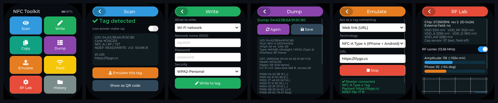
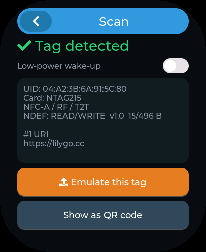
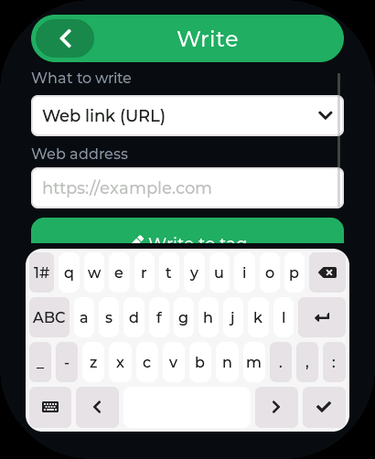
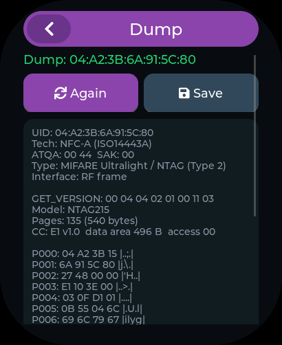
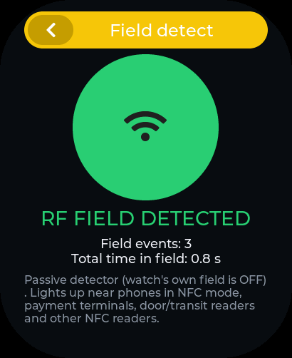

# NFC Toolkit for the LilyGO T-Watch Ultra

A complete NFC app for the **LilyGO T-Watch Ultra** (ESP32-S3 + **ST25R3916**): scan, write, copy, dump and emulate NFC tags, detect NFC readers, and look inside the radio, all from the watch's touchscreen.



[](https://github.com/SKIrf26/NFC-Toolkit/actions/workflows/build.yml)
&nbsp;**[User guide (PDF)](docs/NFC_Toolkit_User_Guide.pdf)** · **[Flash the firmware](#install)** · **[What it can read](#supported-tags)**

---

## Features

| | Tool | What it does |
|---|---|---|
| 👁 | **Scan** | Reads the UID, chip model, technology and NDEF records (URL, text, Wi-Fi, vCard, AAR...) from NFC-A, NFC-B, NFC-F, NFC-V and ST25TB tags. One tap to **show as QR**, **join the Wi-Fi** on the tag, or **emulate** it. Optional **low-power wake-up** mode. |
| ✏️ | **Write** | Web link, text, Wi-Fi (WPA2 / WPA-WPA2 / open), phone call, SMS, email, contact (vCard), map location, launch Android app, **erase**, **format**. Blank tags are formatted automatically and every write is read back to verify it. |
| 📋 | **Copy** | Clones the NDEF content of one tag onto another, even across tag types. It won't overwrite the source by mistake. |
| 🧾 | **Dump** | Full memory dump: NTAG21x/Ultralight pages + **NXP originality signature**, ISO15693 blocks (incl. >256-block ST25DV/ICODE DNA), ST25TB, FeliCa Lite, Type 4 NDEF files, and the app names on payment cards. Saves `.txt` + `.bin`. |
| 📡 | **Emulate** | The watch becomes an NFC tag with a URL, text or Wi-Fi login: NFC-A Type 4 (iPhone + Android), NFC-F Type 3, or both. Live reader/read counters. |
| 📶 | **Field** | Passive detector for phones, payment terminals and door/transit readers, with vibration and event counter. |
| ⚙️ | **RF Lab** | Chip ID/revision, 5 supply rails, antenna amplitude & phase with live chart, capacitive sensor, and a detune meter that "sees" tags approaching. |
| 🗂 | **History** | Timestamped log of everything scanned or dumped, on microSD (or internal flash). |

The interface is laid out inside the Ultra's rounded-corner AMOLED (410×502) safe area, with haptic feedback on every event. The NFC field is switched off whenever you leave a tool.

<p align="center">
  
  
  
  
</p>

## Supported tags

| Tag / card | Scan | Read NDEF | Write | Dump | Copy |
|---|:-:|:-:|:-:|:-:|:-:|
| NTAG210 / 212 / 213 / 215 / 216 | ✅ | ✅ | ✅ | ✅ full + signature | ✅ |
| MIFARE Ultralight / EV1 | ✅ | ✅ | ✅ | ✅ | ✅ |
| MIFARE Classic 1K / 4K / Mini | UID only | ❌ | ❌ | UID only | ❌ |
| DESFire, NTAG 424, ST25TA (Type 4) | ✅ | ✅ if formatted | ✅ if unlocked | NDEF file | ✅ |
| ICODE SLIX/SLIX2/DNA, ST25DV/TV, Tag-it (ISO15693) | ✅ | ✅ | ✅ | ✅ full | ✅ |
| FeliCa Lite / Lite-S | ✅ | ✅ | ✅ | open blocks | ✅ |
| FeliCa standard (Suica, Octopus...) | IDm only | ❌ | ❌ | IDm only | ❌ |
| ST25TB / SRI512 / SRIX4K | ✅ | ❌ | ❌ | ✅ full | ❌ |
| Bank / payment cards (EMV) | ✅ | app names | ❌ | app names only | ❌ |

**Emulate** is readable by iPhone XS and newer (Type 4) and by Android (Type 4 or Type 3). The [user guide](docs/NFC_Toolkit_User_Guide.pdf) has the details for every tool.

## Install

### Option A: flash the prebuilt firmware

Download [`firmware/NFC_Toolkit_TWatchUltra_0x0.bin`](firmware/NFC_Toolkit_TWatchUltra_0x0.bin) (bootloader + partitions + app) and write it at offset **0x0**:

```bash
pip install esptool
esptool --chip esp32s3 --port /dev/ttyACM0 --baud 921600 write-flash 0x0 NFC_Toolkit_TWatchUltra_0x0.bin
```

Windows: `--port COM5`, macOS: `--port /dev/cu.usbmodem*`. You can also use Espressif's browser-based **ESP Tool** (Chrome/Edge): add the file at address `0x0` and press Program.
If the port doesn't appear, hold **BOOT**, tap reset/power, release BOOT.

Every push to `main` also builds the firmware in CI. Download it from the latest [Build run](https://github.com/SKIrf26/NFC-Toolkit/actions/workflows/build.yml) → *Artifacts*.

### Option B: build from source

**Arduino IDE 2.x**

1. Boards Manager → install **esp32 by Espressif Systems ≥ 3.3.0** (CI uses 3.3.12).
2. Install [LilyGoLib](https://github.com/Xinyuan-LilyGO/LilyGoLib) and copy every folder from [LilyGoLib-ThirdParty](https://github.com/Xinyuan-LilyGO/LilyGoLib-ThirdParty) into your `Arduino/libraries` folder (it provides `ST25R3916-NFC-RFAL`, `lvgl` 9.x, `SensorLib`, ...).
3. Open `NFC_Toolkit/NFC_Toolkit.ino` and select:

   | Setting | Value |
   |---|---|
   | Board | **LilyGo T-Watch-Ultra** |
   | USB CDC On Boot | Enabled |
   | Partition Scheme | 16M Flash (3MB APP / 9.9MB FATFS), the default |

4. Upload.

**arduino-cli**

```bash
arduino-cli compile -b esp32:esp32:twatch_ultra NFC_Toolkit
arduino-cli upload  -b esp32:esp32:twatch_ultra -p /dev/ttyACM0 NFC_Toolkit
```

## Using it

Tap a tile to open a tool. **◀** in the header (or the **BOOT** button) goes back home. Hold tags flat against the watch; range is a few centimetres. If you're not sure where the antenna is, use **RF Lab**'s detune meter to find the sweet spot.

Files are saved under `/nfc/` on the microSD card (or the internal FAT partition if there's no card):
`history.tsv`, `dump_<UID>_<time>.txt` and `dump_<UID>_<time>.bin`.

See the **[user guide PDF](docs/NFC_Toolkit_User_Guide.pdf)** for a walkthrough of every screen, compatibility details and troubleshooting.

## How it works

```
NFC_Toolkit/
├── NFC_Toolkit.ino    setup/loop; boots the watch without GPS/LoRa/audio/IMU to save power
├── nfc_engine.*       sole owner of the ST25R3916
│                        Scan + Emulate  → LilyGoLib's LilyGoNfcService
│                        Write/Copy/Dump/Field/RF Lab → ST RFAL directly (NFCReader, nfc_hw)
├── ndef_builder.*     byte-exact NDEF encoder (URI prefixes, Text, Wi-Fi WSC, MIME, AAR,
│                      short/long records) + human-readable decoder
├── storage.*          history + dump files on SD or internal FAT
└── ui.cpp             LVGL 9 UI, laid out inside the rounded-display safe area
```

Only one NFC mode runs at a time. Starting a tool stops the previous one, and leaving a screen turns the RF field off.

## Development tools

| Path | What it is |
|---|---|
| `test/run.sh` | Host unit tests for the NDEF encoder/decoder (`g++` only). |
| `tools/simulator/build_and_run.sh` | Desktop simulator: compiles the **real** `ui.cpp` with LVGL for your PC, hardware stubbed, renders every screen at 410×502, checks nothing falls into the rounded corners, and refreshes `docs/screenshots/`. |
| `tools/guide/make_guide.py` | Regenerates the PDF user guide from the screenshots (`pip install reportlab`). |
| `.github/workflows/build.yml` | CI: unit tests + full firmware build for `esp32:esp32:twatch_ultra`, firmware uploaded as an artifact. |

## Limitations

- **MIFARE Classic**: sector data is encrypted with NXP's Crypto1, which the ST25R3916 has no hardware for. Only UID/ATQA/SAK are read.
- **UIDs can't be cloned.** Copy transfers the NDEF content; each chip's UID is fixed at the factory.
- **No permanent lock / read-only.** It's left out on purpose because it's irreversible.
- **Type 4 emulation** is marked experimental in LilyGoLib. If a phone won't read it, try *Mixed* or *Type 3*.
- **Payment cards**: only the public application directory (app names/AIDs) is read. Card numbers and transactions are never requested.
- The screen layout has been verified in the simulator. Hardware reports and photos are welcome via Issues.

Please only read, write or copy tags and cards that you own or have permission to use.

## Credits

- [LilyGoLib](https://github.com/Xinyuan-LilyGO/LilyGoLib) by LilyGO: board support and `LilyGoNfcService` (scan + emulation)
- [ST25R3916 RFAL](https://github.com/Xinyuan-LilyGO/LilyGoLib-ThirdParty) by STMicroelectronics (Arduino port by LilyGO)
- [LVGL](https://lvgl.io): graphics library

## License

[MIT](LICENSE) for this project's code. Third-party libraries keep their own licenses. The ST RFAL library used to build the firmware is licensed by STMicroelectronics under its own terms.
